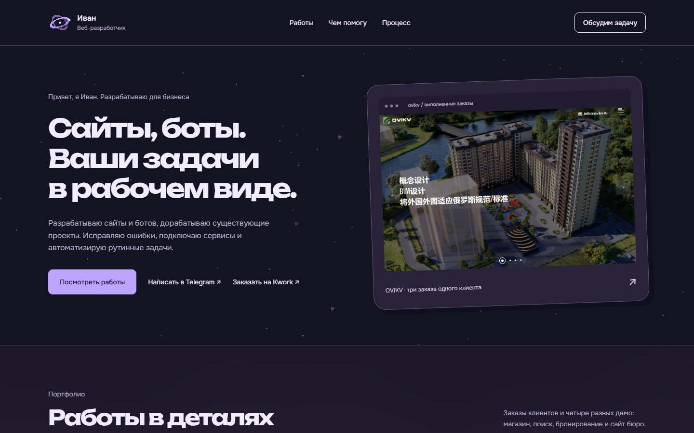

# Портфолио — сайт фриланс-разработчика

Одностраничный сайт: работы, услуги, порядок работы и форма заявки.
Чистые HTML + CSS + JS без сборщика и фреймворков — публикуется на GitHub Pages как есть.

**Живой адрес:** <https://einsteinring.github.io/portfolio/>



- **Стек:** HTML5, CSS (кастомные свойства, Grid, Flex), ванильный JS без зависимостей.
- **Внешние ресурсы:** только шрифты Unbounded (заголовки) и Onest (текст) с Google Fonts.
- **Данные работ:** [`projects.json`](projects.json) — карточки и кейсы рендерятся из него.

## Структура

```
portfolio/
├── index.html              # вся разметка страницы
├── projects.json           # работы: заказы и демо
├── css/
│   └── styles.css          # токены в :root → база → секции → адаптив
├── js/
│   ├── projects.js         # загрузка projects.json, фильтр, карточки, панель кейса
│   ├── form.js             # валидация формы + отправка в lead-api
│   ├── main.js             # мобильное меню, год в подвале
│   ├── ambient.js          # пиксельный фон на canvas
│   └── logo.js             # анимация пиксельного логотипа
├── assets/
│   ├── favicon.svg, logo.svg
│   ├── og.png              # превью ссылки в мессенджерах, 1200×630
│   └── previews/*.webp     # скриншоты работ, 1280×800
├── docs/
│   ├── preview.png         # скриншот для этого README
│   └── og-source.html      # исходник og.png
└── .nojekyll               # чтобы GitHub Pages отдавал файлы как есть
```

## Локальный запуск

Страница читает `projects.json` через `fetch`, поэтому двойной клик по `index.html` не подойдёт:
браузер заблокирует запрос с `file://`. Из папки с `index.html`:

```bash
python -m http.server 4173 --bind 127.0.0.1
```

Затем откройте <http://localhost:4173>. Порт 4173 разрешён в lead-api, так что форма работает и
локально (заявка уйдёт в настоящий Telegram).

## Дизайн

- **Палитра:** тёмный фон `#141321`, лавандовый акцент. Цвета и радиус — в `:root` в начале
  [`css/styles.css`](css/styles.css). Файл дописывался слоями: более поздние правила внизу
  переопределяют ранние, поэтому новые правки удобнее добавлять в конец.
- **Фон:** [`js/ambient.js`](js/ambient.js) рисует звёзды и горы на canvas в трети разрешения,
  до 10 кадров в секунду, с паузой в скрытой вкладке. Кнопка в подвале останавливает фон и
  анимацию логотипа; при `prefers-reduced-motion` всё статично.
- **Сетка работ:** две колонки. При нечётном числе работ первая карточка растягивается на всю
  строку, чтобы последняя не оставалась в ряду одна. Скриншоты показываются целиком, 16:10.

## Как добавить работу

1. Положите скриншот в `assets/previews/`: 1280×800 (16:10), лучше WebP. Сжать PNG можно так:
   `python -c "from PIL import Image; Image.open('shot.png').convert('RGB').save('shot.webp', quality=84, method=6)"`.
2. Добавьте объект в [`projects.json`](projects.json). Заказы (`kind: "client"`) всегда идут
   первыми, остальные — в порядке массива.
3. Пересобирать ничего не нужно: счётчики фильтра пересчитаются сами.

### Поля объекта

| Поле               | Обязательное | Что в нём                                                                 |
| ------------------ | ------------ | ------------------------------------------------------------------------- |
| `id`               | да           | Короткий слаг. Кейс открывается по ссылке `#case-<id>`                     |
| `kind`             | да           | `client` — заказ с Kwork, `demo` — собственный демо-проект                 |
| `title`            | да           | Название на карточке и в кейсе                                             |
| `tagline`          | да           | Одна-две строки под названием                                              |
| `task`, `solution`, `result` | да | Кейс: «Задача», «Решение», «Результат»                                |
| `tags`             | да           | Теги для строки под описанием: `landing`, `catalog`, `bot`, `miniapp`, `integration`, `optimization` |
| `tech`             | да           | Стек: чипы в кейсе и на широкой карточке                                   |
| `preview`          | нет          | Путь к скриншоту. Пусто — вместо картинки пустая плашка                    |
| `demoUrl`          | нет          | Кнопка «Открыть демо» (для заказа — «Открыть сайт»)                        |
| `repoUrl`          | нет          | Кнопка «Код на GitHub»                                                    |
| `sourceUrl`        | нет          | Кнопка «Профиль на Kwork» в кейсе                                          |
| `formatLabel`      | нет          | Подпись над названием демо, например «Сервис поиска»                       |
| `workFormat`       | нет          | Для заказа: строка «Формат работы» в кейсе                                 |
| `features`         | нет          | Список «Ключевые сценарии» в кейсе                                         |
| `technicalDetails` | нет          | Раскрывающийся блок. Абзацы разделяются пустой строкой (`\n\n`); если в абзаце несколько строк, первая станет заголовком |
| `published`        | нет          | `false` скрывает работу                                                    |

Не публикуйте архивы заказчиков, переписку и персональные данные.

## Форма заявки

Форма проверяет поля на странице, а отправку делает `sendLead(data)` в [`js/form.js`](js/form.js).
Токена Telegram-бота в репозитории нет: заявку принимает отдельный обработчик на Vercel
([Einsteinring/lead-api](https://github.com/Einsteinring/lead-api)), токен живёт в его переменных
окружения.

```
браузер  →  POST https://lead-api-blue.vercel.app/api/lead  →  Telegram Bot API  →  ваш чат
```

Обработчик принимает запросы только с этого сайта и с `localhost:4173`/`5173`, пропускает не больше
5 заявок с одного IP за 10 минут (счётчик в Upstash Redis) и молча отбрасывает заявки с
заполненным скрытым полем `company` — ловушкой для ботов. Если хранилище недоступно, форма
ответит ошибкой и предложит написать в Telegram.

## Превью ссылки

`og.png` собирается из [`docs/og-source.html`](docs/og-source.html): откройте файл через локальный
сервер в окне 1200×630 и сделайте скриншот, например headless Edge:

```bash
msedge --headless=new --hide-scrollbars --window-size=1200,630 --screenshot=assets/og.png http://localhost:4173/docs/og-source.html
```

После замены картинки поменяйте `?v=` у `og:image` в [`index.html`](index.html), иначе мессенджеры
покажут старую из кэша.

## Публикация

GitHub Pages из ветки `main`, папка `/ (root)`. Сборка не нужна. Если адрес сайта изменится,
поправьте в `index.html` `<link rel="canonical">`, `og:url` и `og:image`.

Исходники демо лежат в отдельных репозиториях и публикуются на Vercel: ШинаПро, Пересменка, Депо,
Литейный. Локальная папка `demo/` с архивами в этот репозиторий не попадает (`.gitignore`).
